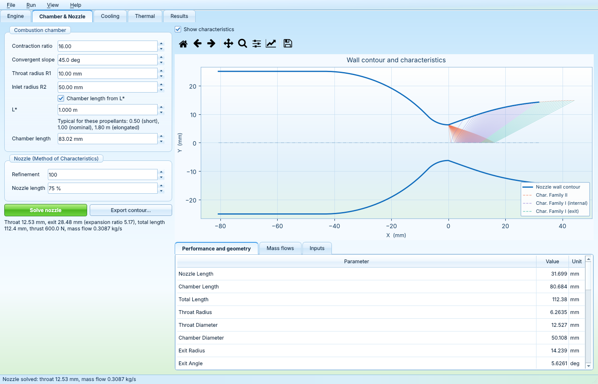
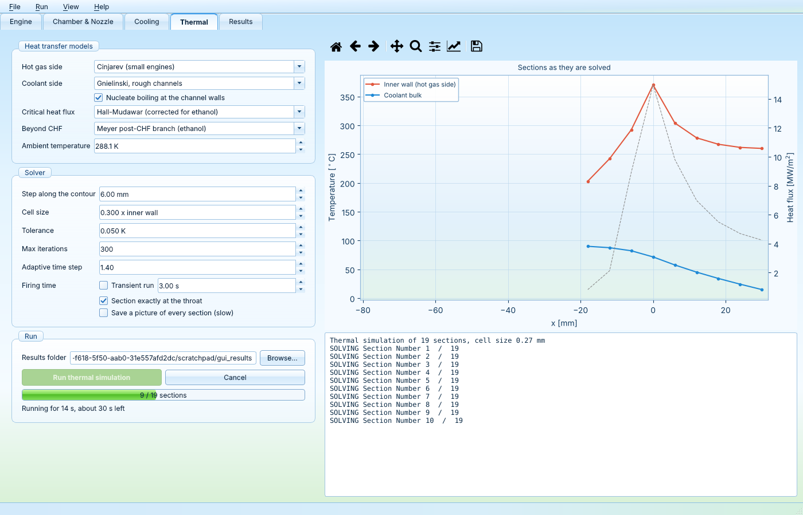
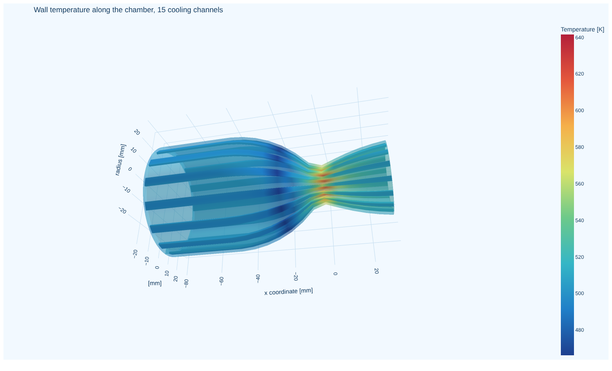

# Thrust Chamber Designer

Design a regeneratively cooled liquid rocket thrust chamber in one tool: the nozzle contour with the Method of Characteristics, and the
wall temperatures, heat fluxes, coolant state and wall stresses along that contour with a 2D thermal model of the cooling channels.
It runs as a desktop app (PySide6), from the command line, or as a Python library.

It combines two earlier tools:

* [Method-Of-Characteristics-Nozzle-Solver](https://github.com/AdmiralOctavio/Method-Of-Characteristics-Nozzle-Solver) (Flavio Cicero):
  2D MoC nozzle after NASA TM X-1502, chamber sizing with L*, thrust and perfect expansion sizing. Documentation in
  [docs/nozzle_solver.md](docs/nozzle_solver.md).
* [Rocket-Engine-Thermal-Simulator](https://github.com/AdmiralOctavio/Rocket-Engine-Thermal-Simulator), based on PyRocket (Jonathan
  Neeser): 2D finite volume sections of the chamber wall along the contour, hot gas and coolant correlations, nucleate boiling and
  critical heat flux, film cooling, helical channels and a wall stress screening. Documentation of the models in
  [docs/thermal_model.md](docs/thermal_model.md).



## Installation

Python 3.10 or newer. All dependencies come as wheels from pip, so no FORTRAN compiler and no separate gmsh installation are needed.

```bash
pip install "thrust-chamber-designer[gui] @ git+https://github.com/AdmiralOctavio/Thrust-Chamber-Designer"
```

or from a clone of this repository:

```bash
pip install -e ".[gui,dev]"
```

On Linux, gmsh and Qt need a few system libraries, e.g. on Ubuntu
`sudo apt install libglu1-mesa libxcursor1 libxinerama1 libxft2 libegl1 libxkbcommon0`.

A Windows build that needs no Python is made by the CI workflow (see Packaging below).

## Use

### Desktop app

```bash
thrust-chamber-designer            # or: python -m thrust_chamber_designer.gui
```

The tabs follow the order of the work:

1. **Engine**: propellants, operating point and injector film. The chart shows the ideal Isp over O/F for the propellants, with the chosen O/F
   and the stoichiometric O/F.
2. **Chamber & Nozzle**: chamber shape (contraction ratio, slope, radii, L* or length) and nozzle settings. *Solve nozzle* (F5)
   sizes the throat and the nozzle for the thrust and perfect expansion, and shows the contour with the characteristics, the
   performance and the mass flows. *Export contour* writes `params.csv`, `Contour.csv`, `Contour.dxf` and an STL.
3. **Cooling**: coolant, film cooling, cooling channels and wall material. Channel height, fill factor, inner wall thickness and
   helix angle can be constant or given as points along the chamber. The preview shows the channels at the throat and the channel
   sizes along the contour against the smallest printable channel.
4. **Thermal**: models and solver settings. *Run thermal simulation* (F6) runs in a separate process: the window stays usable, the
   wall and coolant temperatures appear as the sections are solved, and *Cancel* stops it at any time.
5. **Results**: summary and warnings, the plots of PyRocket (temperatures, heat flux, critical heat flux, heat transfer
   coefficients, coolant pressure, Reynolds number, wall temperature differences, stresses, Bree diagram), the temperature field of
   every section, and the 3D view of the joined sections.

Designs are saved as JSON files (File menu). *View* switches between a light, a dark and an Aero theme (Vista / 7, Frutiger Aero);
the plots and the 3D view follow the theme. In the Aero theme on Windows 11 the title bar and window border take the sky blue of
the theme as well.





### Command line

```bash
tcd new my_engine.json                    # design file with the default inputs
tcd nozzle my_engine.json -o results      # nozzle only
tcd run my_engine.json -o results         # nozzle and thermal simulation, all files and plots in results/
```

### Python

```python
from thrust_chamber_designer.core.design import Design
from thrust_chamber_designer import pipeline

design = Design.load("examples/600N_N2O_ethanol80.json")
nozzle = pipeline.design_nozzle(design)            # contour, performance, mass flows
setup = pipeline.build_thermal(nozzle, "results")  # thermal model on the contour
sim = pipeline.run_thermal(setup)                  # writes results/sim_data.csv and section_fields.npz
```

## How the two models are coupled

* **One chemistry source.** NASA CEA through the `cea` package for everything: the nozzle (chamber temperature, c*, gamma and molar
  mass at the throat, gamma at the exit) and the thermal model (transport properties). rocketcea is not used any more. For the default
  case of the nozzle solver, the throat gamma of the two differs by 2e-5.
* **Expansion ratio.** The exit gamma depends on the expansion ratio, which is only known from the contour. CEA and the nozzle
  sizing are repeated until CEA runs at the expansion ratio of the contour (3 to 4 times). The nozzle solver used a fixed 5.77.
* **Mass budget with film cooling.** The O/F of the design is the core (combustion) O/F, at which CEA runs. Film coolant is extra
  fuel from the same feed:

  ```
  fuel feed = core fuel + film,    film = film fraction x fuel feed
  feed O/F  = core O/F x (1 - film fraction)
  ```

  The throat is sized for everything that goes through it (oxidiser + fuel feed) with the c* of the core, and the cooling channels
  carry the fuel feed (or a set fraction of it). With this sizing the film fraction does not change the nozzle at all, only the
  split of the mass flow: it can be chosen after the nozzle, and the mass flows on the Chamber & Nozzle tab follow it without
  solving again. The injector film is set on the Engine tab next to the core O/F, rings of ports in the wall on the Cooling tab.
  The film is counted as if it gave the exit velocity of the core; its real loss of performance is left to the c* efficiency.
* **One c\* efficiency** for the nozzle sizing and the thermal model.
* **Contour.** The thermal model takes the contour of the nozzle directly, no CSV file. The resampling along the contour puts a
  section exactly at the throat (on PyRocket's example contour the old resampling made the throat area 2.3 % too large).

Together these change the default case of the nozzle solver by little: mass flow -0.26 %, throat radius -0.13 %, expansion
ratio 5.05 to 5.09.

## Note on the critical heat flux

From the use of the thermal model for DLX-1000A, a regeneratively cooled N2O / ethanol engine: the model predicted the critical heat
flux to be exceeded by a factor of about 2.5 to 3 around the throat and in the nozzle, yet the engine survived 2 s and 3 s test
burns. Exceeding the CHF would lead to failure within about 0.1 s, so either the CHF is underestimated a lot, or it is not what
decides failure here. Keep this in mind when judging the CHF results of your own engine (see also the post-CHF options in
[docs/thermal_model.md](docs/thermal_model.md)).

## Tests

```bash
pytest            # about 35 s; pytest -m "not slow" skips the two thermal runs
```

The regression tests compare against results of the original code: the nozzle solver reproduces the contour, mass flow and thrust
of the original solver to 1e-9 (with the same combustion properties), and PyRocket's example case matches its original
`sim_data.csv` to 1e-6.

## Packaging

`packaging/thrust_chamber_designer.spec` builds a folder with an executable with PyInstaller:

```bash
pip install ".[gui]" pyinstaller
pyinstaller --noconfirm packaging/thrust_chamber_designer.spec
dist/ThrustChamberDesigner/ThrustChamberDesigner --self-test some_folder    # nozzle and a coarse thermal run, exit code 0 if it works
```

The GitHub Actions workflow runs the tests on Linux and builds the Windows app, runs its self test and uploads it as an artifact
(Actions tab, *ThrustChamberDesigner-windows*). The packaged app leaves out QtWebEngine (about 400 MB), so the 3D view opens in the
web browser there.

## License

GNU General Public License v3, like both tools it is based on.
